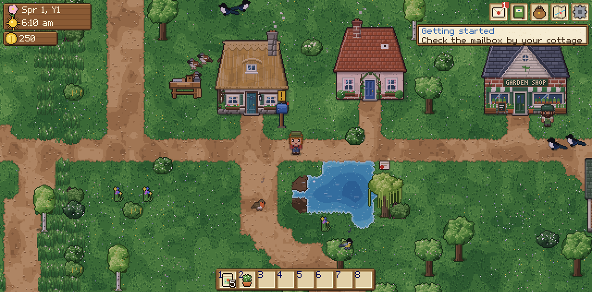
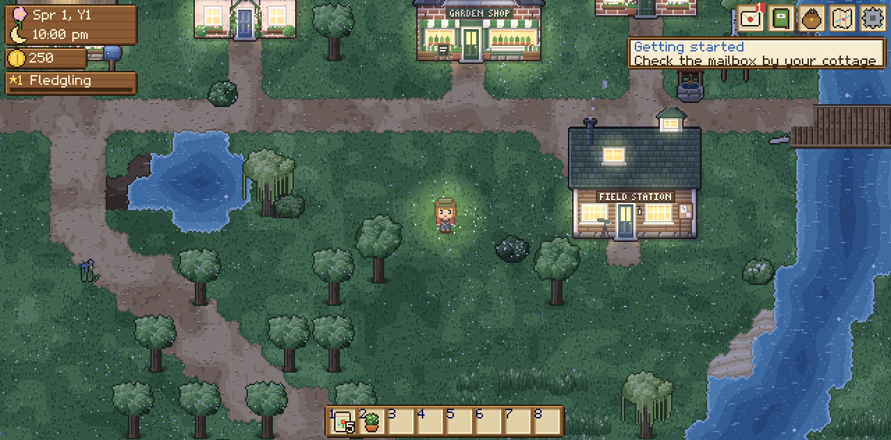

# Nested 🪺

**A cozy pixel-art life sim about bringing birds back to a valley.**
Find clues about 67 real European birds, gather the exact materials each one uses for its nest,
create the habitat it needs — and watch eggs hatch and chicks fledge. Play alone or build habitats together in co-op.



Everything — the pixel art, the font, the music, the bird songs and the sound effects — is generated by the game's own code.
No external assets, libraries or frameworks.

---

## Play

### Solo (no install)
Double-click **`index.html`** (or `dist/nested.html`, a single-file build) to open it in Chrome, Firefox, Edge or Safari.
Saves are stored in your browser (3 save slots).

### Co-op (play together on your network)
Requires Python 3 (pre-installed on macOS and most Linux distros; on Windows get it from python.org). Nothing else.

```bash
python3 server.py            # then open the printed address, e.g. http://192.168.1.20:8080
```

1. One player opens the address and chooses **Host Co-op** (their save becomes the shared valley).
2. Friends on the same network open the same address and choose **Join Co-op**.
3. Everyone shares the valley, the coins and the nest-material pouch; each player has their own bag.
   The day ends when everyone has gone to bed.

Up to 6 players. Use `python3 server.py --port 9000` if port 8080 is busy.
(To play over the internet, forward the port on the host's router or use a VPN such as Tailscale.)

---

## Controls

| Action | Keyboard / mouse | Gamepad | Touch |
|---|---|---|---|
| Move | WASD / arrow keys | Left stick / d-pad | Drag on the left side |
| Run | hold Shift (or turn on *Always run*) | LT / RT / press the stick | *Always run* setting |
| Interact (gather, talk, plant, place, observe) | **E** / Space / left-click | A | **A** button |
| Nest site / details · give the item in your hand to a villager | **F** / right-click | X | **B** button |
| Hotbar | 1–8, mouse wheel, Q / R | LB / RB | tap a slot |
| Journal · Bag · Map | Tab (J) · I (B) · M | Y · – · Back | top-right buttons |
| Map: set a pin · quick travel | click the map · click a blue point | select a blue point | tap |
| Menu / close | Esc | B / Start | ✕ |
| Chat (co-op) | T or Enter | – | – |

Prompts above things always tell you what **E** and **F** will do.

---

## How to play

1. **Collect clues.** Every bird has three clues: *who and where*, *where it nests*, *what its nest is made of*.
   Get them by **observing** visiting birds (walk close, stand still, press E), picking up sparkling **Field Notes**,
   and asking **Prof. Ada** at the Field Station for leads. Three clues = the nest blueprint.
2. **Gather materials** into the shared pouch — each material has its own place and rhythm:
   shake trees for twigs, peel bark flakes from old pines, cut long grass, scoop mud (puddles after rain!), scrape moss in the forest and lichen in the hills,
   brush Mabel's sheep and horse, pick up feathers at the coop, wind dewy spider silk before 11:00,
   crumble rotten logs, pick thistle down, shake willows for seed fluff, dig sand and clay at the river…
3. **Make habitat.** Buy native seeds and saplings from Basil, plant hedges, trees, thistles, herbs and reed beds,
   dig ponds, and craft nest boxes (25, 28 and 32 mm holes), an owl box, a stork platform, an earth bank or a brush pile
   at your workbench.
4. **Build the nest** at the right site (press **F** there). The panel shows every habitat need with ✓/✗.
   If the habitat is right and it's the breeding season, a pair moves in, lays eggs, and raises chicks.
5. When the chicks fledge, the species counts as **nested**, you get a conservation grant, and new birds start visiting.
   Nest all **67 species** to restore the valley.

Sleep in your cottage to end the day: plants grow, eggs hatch and chicks fledge overnight. Seasons last 7 days.
Most birds nest in spring and summer — but Barn Owls and Wood Pigeons still breed in autumn, Crossbills breed in **winter**,
and Grey Herons start building in late winter.

**Birds of the night:** owls, the nightjar, the nightingale, the corncrake, the water rail and the stone-curlew only show themselves from
dusk until dawn. Nights are moonlit, not black: the valley turns blue and silver, windows, lanterns and lamp posts glow
warm, and fireflies dance on summer nights. Stay up late and listen — or, when you play alone, **rest until evening**
at your cottage door or on a garden bench.



**Rare visitors:** about one day in five, a villager reports an unusual bird passing through — a Hoopoe, a Golden Oriole,
Waxwings, an Osprey, a Bluethroat, a Hawfinch, a Red Kite, a Common Crane, a Wallcreeper, a Spoonbill, a White-tailed Eagle or a Rosy Starling, each in its own season. It stays for that day only; look for the sparkle.

**Everyday birds:** House Sparrows, Starlings, Magpies, Carrion Crows, Rooks, Collared Doves and Black-headed Gulls live in the valley all year,
and Woodcocks and Little Owls come out at dusk. They don't need your help, but watching them always teaches you something.

**Villagers:** Prof. Ada, Basil, Mabel, Old Tom the fisherman, Edith and her granddaughter Rosie, Finn the
photographer, Juniper the forest ranger and — after dark — Luna the night birder all go about their day on their own
routes. A yellow **!** means someone needs a hand. Their **34 requests** send you exploring every corner of the valley:
lost things to find, materials to bring, parcels to carry from one neighbour to another, landmarks to visit at dawn or
after dark, nest boxes and bird baths to put up, and birds to help nest. Each of the seven hidden **landmarks** earns
coins when you discover it.

**Friends:** talk to villagers every day and give them little gifts (hold something and press **F** in front of them —
everyone has favourites). Friendships grow in hearts; at 2 and 4 hearts they tell you their stories, and best friends
give you a keepsake. The **Notice Board** by the well posts two small, optional requests every morning.

**Birder rank & badges:** everything you do for the birds — watching them, finding clues, building nests, seeing chicks
fledge, helping neighbours, exploring — earns experience. Fifteen ranks (from *Fledgling* to *Legend of the Valley*) bring
coins, saplings, better binoculars, quieter steps and new workbench recipes: a **bird feeder** (birds really visit it), a
**lamp post** and a **garden bench**. Seventeen badges celebrate milestones; the journal's **Progress** page shows how
close you are to each.

**Comfort features:**
- **Guide arrow** — an arrow at the edge of the screen points to whatever you're working on: the next tutorial step, a
  request you chose with **Guide** in the journal, a pin you dropped on the map, or a nest spot.
- **"Where can it nest?"** — in the journal, for any bird whose blueprint you know. It finds every spot in the valley
  where that bird would move in right now (marked with green arrows and on the map). If there's none yet, it shows the
  closest spot and exactly what it's still missing.
- **Map** — click anywhere to drop a pin; click a blue point (home, the Field Station, the farm or a landmark you've
  found) to travel there straight away.
- **Journal** — filter the birds (need clues · ready to build · nested · here today), and read back every message and
  morning summary in the **Diary**.
- **Settings** — *Always run*, *View* (wide / normal / close), *Day length* (10, 15 or 20 real minutes) and *Effects*:
  **Auto** uses the full look and switches to **Light** by itself if the game runs slowly for a while
  (Light skips the daytime weather dimming and the extra night colour pass, and uses fewer raindrops).
- **Little helpers** — *Sort* in the bag, *Sell all forage* at Basil's, and the journal remembers which gifts each
  villager loves.

**Make it yours:** the character creator (and the **Wardrobe** in the pause menu) has 12 hairstyles, 14 hair colours,
9 skin tones, eye colours and four eye shapes, 10 kinds of top, trousers/shorts/skirts, shoes, 8 hats, glasses and
accessories like binoculars, a camera, a scarf, a backpack or a satchel. Hit **Surprise me** for a random birder.

### The birds (spoilers!)

<details>
<summary>All 67 species with their nests</summary>

| Bird | Nest site | Materials | Special needs |
|---|---|---|---|
| Eurasian Blackbird | shrub | twigs, dry grass, mud | short lawn (worms) |
| European Robin | open-fronted nest box | dead leaves, moss, horsehair | shrubs, lawn, territorial |
| Great Tit | nest box, 28 mm hole | moss, wool, horsehair, feather | trees (caterpillars) |
| Blue Tit | nest box, 25 mm hole | moss, feathers, wool, **fragrant herbs** | trees |
| Song Thrush | shrub | twigs, grass, moss, mud, **rotten wood** | an **anvil stone** for snails |
| Wood Pigeon | broadleaf tree | just 4 twigs (a flimsy platform) | trees; breeds into autumn |
| Eurasian Wren | brush pile | moss, leaves, grass → **two cock nests**, then a feather lining | dead wood, undergrowth |
| Barn Swallow | inside the barn | mud, grass, feathers | water & mud nearby |
| House Martin | under house eaves | lots of mud, grass, feather | water & mud nearby |
| Mallard | long grass by water | grass, dead leaves (+ her own down) | cover, water |
| Eurasian Nuthatch | nest box, 32 mm hole | **pine bark flakes**, mud (to plaster the hole), leaves | big trees |
| Pied Flycatcher | nest box, 28 mm hole | leaves, grass, bark, horsehair | oak woodland |
| European Goldfinch | broadleaf tree | moss, lichen, spider silk, **thistle down**, wool | thistles nearby |
| Long-tailed Tit | thorny shrub | moss, spider silk, lichen, **many feathers** | scrub & trees |
| Great Spotted Woodpecker | standing dead tree | none (it chisels a hole) | woodland, dead wood |
| Eurasian Reed Warbler | dense reed bed | grass, reed plumes, spider silk | 8+ reeds close together |
| Common Crossbill | pine | twigs, moss, lichen, horsehair, feather | pines; breeds in **winter** |
| Eurasian Skylark | long grass in the open | dry grass | big meadow, no trees nearby |
| Little Ringed Plover | bare gravel by water | a few small stones | open shingle at the water's edge |
| Common Nightingale 🌙 | dense shrub | dead leaves, grass, horsehair | a tangled thicket |
| White-throated Dipper | beside a bridge | moss, grass, leaves | fast, clean river |
| Sand Martin | earth bank at the water's edge (colonial) | grass, feathers | open water |
| Western Jackdaw | a chimney | lots of sticks, wool, horsehair | short grass to feed on |
| Common Kingfisher | earth bank at the water's edge | none (digs a tunnel) | lots of water |
| Barn Owl 🌙 | owl box | none (lays on pellets) | large uncut meadow (voles) |
| Eurasian Penduline Tit | willow over water | seed fluff, grass, spider silk | reeds nearby |
| Common Cuckoo | another bird's nest! | – | a Reed Warbler nest with fresh eggs |
| Common Swift | under house eaves | feathers, seed fluff, grass (all caught in the air) | insects over water |
| Tawny Owl 🌙 | owl box in woodland | none | mature woodland; nests early |
| Grey Heron | broadleaf tree | sticks, twigs, grass | water and a group of tall trees; starts in **winter** |
| European Nightjar 🌙 | bare ground in a woodland clearing | none | trees around, nothing overhead |
| Long-eared Owl 🌙 | pine (an old stick nest) | sticks, twigs | pines next to rough grassland |
| Corncrake 🌙 | long grass in the open | dry grass | a big uncut hay meadow |
| White Stork | stork platform | sticks, twigs, grass, mud | wet meadow, long grass, open space |
| Red-backed Shrike | thorny shrub | grass, moss, wool, horsehair | flowery grassland, thorny scrub |
| European Bee-eater | earth bank in the open | none (digs a tunnel) | lots of flowers buzzing with bees |
| Eurasian Eagle-Owl 🌙 | rock ledge in the hills | none (a scrape) | steep rocky ground; nests in late winter |
| Goldcrest | pine (hung under a branch) | moss, spider silk, lichen, feathers | pines all around |
| Eurasian Treecreeper | standing dead tree (behind loose bark) | twigs, moss, feather | woodland with many trunks |
| Eurasian Bullfinch | thorny shrub | fine twigs, horsehair | thick shrubs and a few trees |
| Yellowhammer | shrub (at its foot) | dry grass, horsehair | rough long grass along a hedge |
| Common Kestrel | rock ledge in the hills | none (a scrape) | crags, and rough grassland full of voles |
| Northern Lapwing | long grass or marsh by water | a little grass | open wet meadow, no trees |
| Water Rail 🌙 | dense reed bed | dead leaves, dry grass | a big reed bed |
| Eurasian Scops Owl 🌙 | broadleaf tree (a hollow) | none | orchard trees and flowers full of moths |
| Common Chaffinch | broadleaf tree | moss, lichen, spider silk, feather | trees around |
| Eurasian Blackcap | thorny shrub | dry grass, horsehair | thick undergrowth and tall trees |
| White Wagtail | inside the barn | grass, moss, horsehair, feather | short grass to chase insects on |
| European Green Woodpecker | broadleaf tree (it carves a hole) | none | short lawns full of ants |
| Eurasian Jay | broadleaf tree in the forest | sticks, twigs, horsehair | oaks (acorns!) and thick woodland |
| Common Redstart | nest box, 32 mm hole | grass, moss, feather, horsehair | old trees |
| Great Crested Grebe | dense reed bed (a floating nest) | dead leaves, dry grass | a big stretch of open water |
| Common Tern | bare gravel by water | a pebble or two | open water, no trees nearby |
| Eurasian Stone-curlew 🌙 | bare gravel by water | none (a scrape) | wide open ground |
| Western Marsh Harrier | dense reed bed | sticks, twigs, grass | a large reed bed, water and rough meadows |
| Common Chiffchaff | shrub (a domed nest) | grass, dead leaves, feather | bushes and trees |
| Common Moorhen | dense reed bed | dry grass, dead leaves | water close by — even a small pond |
| Stock Dove | owl box in the woods | a twig | old woodland |
| Black Redstart | under house eaves | grass, moss, horsehair, feather | bare ground and short grass |
| European Turtle Dove | thorny shrub | twigs (a see-through platform) | thick scrub and flowers for seeds |
| Spotted Flycatcher | open-fronted nest box | grass, moss, horsehair, spider silk | trees and flowers full of insects |
| Northern Wheatear | rock ledge in the hills | grass, moss, feather | rocks with crevices |
| Grey Wagtail | beside a bridge | grass, moss, horsehair | fast, clean water |
| Eurasian Siskin | pine | twig, moss, lichen, feather | pines full of cones |
| Mute Swan | dense reed bed (a huge mound) | grass, dead leaves, sticks | a big stretch of open water |
| Common Buzzard | broadleaf tree | sticks, twigs, fresh leaves | woodland and rough meadows for voles |
| Tengmalm's Owl 🌙 | owl box among the pines | none | old conifer forest |

🌙 = only seen from dusk until dawn.

</details>

Nesting facts in the game are based on general ornithological references (RSPB, BTO, Cornell Lab, HBW summaries);
game durations are shortened — the journal lists the real clutch sizes, incubation and fledging times.

---

## Design notes: what makes it engaging

The third update was planned around what player-experience research says keeps people coming back to a game, and
what makes a "cozy" game feel cozy. The evidence is mostly small studies and design frameworks, so these are design
principles to test, not proven laws.

| Research finding | What it means here |
|---|---|
| **Competence, autonomy and relatedness.** Self-Determination Theory studies find that games satisfying these three needs are enjoyed more and played longer ([Ryan, Rigby & Przybylski 2006](https://pure.ewha.ac.kr/en/publications/the-motivational-pull-of-video-games-a-self-determination-theory-/)), with recent work linking need satisfaction to wellbeing ([Games & Culture 2023](https://www.ebsco.com/articles/sports-and-leisure/8f5b22f9-782e-5c3f-8b1b-e013013b4fee/last-man-standing-battle-royale-games-through-the-lens-of-self-determination-theory)). | *Competence:* birder rank, an XP bar, rank-up rewards and quest progress counters. *Autonomy:* every request, notice and badge is optional, and many different activities earn progress. *Relatedness:* friendships, hearts and personal stories, deliveries that connect neighbours, and co-op. |
| **Cozy games rest on safety, abundance and softness**: no threats or penalties, plentiful resources, comforting looks and sounds ([DiGRA paper](https://dl.digra.org/index.php/dl/article/download/3058/3042/3101); see also [Erasmus University 2024](https://thesis.eur.nl/pub/74942/) and a [Utrecht thesis](https://studenttheses.uu.nl/handle/20.500.12932/47430) on slow pacing and low stakes). | Nothing can be lost or failed: board tasks are optional, materials regrow, gifts are never "wrong". Nights are moonlit and gentle instead of dark and threatening. |
| **Curiosity comes from information gaps** that the player can close ([To et al., DiGRA 2016](https://dl.digra.org/index.php/dl/article/view/793)). Curiosity was also the strongest predictor of enjoyment and playtime in a CHI 2024 study of game feedback ([Kao et al.](https://spiral.imperial.ac.uk/entities/publication/253c32f5-d124-4a23-88b5-9aaaf114608d)). | Three clues per bird, silhouettes in the journal, "???" landmarks and rare-visitor slots, sparkling rare birds that stay one day, night-only birds, and quests that send you to new places at dawn or after dark. |
| **Moderate "juice" works best**: none, or too much, feedback makes the experience worse ([game-feel survey](https://arxiv.org/pdf/2011.09201); [Hicks et al.](https://dl.digra.org/index.php/dl/article/view/936)). | Short confetti, a fanfare and a card on rank-up; hearts for gifts; small "+XP" floats. Nothing flashes or interrupts play for long. |
| **Badges, levels and progress bars** are among the most effective motivational elements, especially in combination ([2024 meta-analysis](https://opus4.kobv.de/opus4-ohm/frontdoor/index/index/year/2024/docId/2476)). Meta-analyses don't support the idea that such rewards undermine intrinsic motivation in games ([Kao, CHI 2018](https://people.csail.mit.edu/dkao/pdf/kao2018chi.pdf)). | Badges are informational ("you did this"), never controlling. Each shows a progress bar, and ranks show exactly what the next one brings. |
| **Goal gradient and endowed progress**: people speed up as a goal gets close, and a head start increases completion ([Nunes & Drèze 2006](https://msbfile03.usc.edu/digitalmeasures/jnunes/intellcont/Endowed%20Progress%20Effect-1.pdf)). | The first rank comes quickly (Ada's first clues already half-fill the bar), and every badge and quest shows how close you are. |
| **Relatedness in single-player games** can come from characters and stories, though this is understudied ([eudaimonic gaming, 2025](https://arxiv.org/pdf/2507.18084)). | Villagers have routines, tastes, stories at 2 and 4 hearts, and keepsakes at 5. Some requests are about each other, not about you. |

---

## Project layout

```
index.html          the game (loads the scripts below)
server.py           co-op server: static files + WebSocket relay (Python standard library only)
build.py            bundles everything into dist/nested.html
js/core/            helpers and constants
js/data/            species, items, plants, villagers & their routes, side quests, landmarks, letters,
                    ranks, badges, gift tastes and notice-board requests — easy to edit
js/sim/             map generation, rules and the authoritative World (runs on the solo player / co-op host)
js/art/             code that draws all pixel art: birds, terrain, trees, buildings, people, icons, font
js/client/          rendering, input, audio synthesis, UI screens, HUD, game loop
js/net/             solo / host / guest links
assets/             PNG sprite sheets exported from the art code (for viewing/reuse)
tools/              developer tools (headless-Chrome tests, art export)
```

The host's browser runs the authoritative world simulation; the Python server only relays messages,
so solo and co-op use exactly the same game code.

**Adding a bird:** add an entry to `SPECIES` in `js/data/species.js` (colours for one of the body templates in
`js/art/birds.js`, nest site, materials, habitat needs, three clues and facts) and a song pattern in `js/client/audio.js`.

**Developer tools** (optional, need Google Chrome and `pip install websockets`):
`python3 tools/playtest.py` runs a scripted playthrough with screenshots,
`python3 tools/speciestest.py` checks that every species can be nested on the generated map,
`python3 tools/export_art.py` re-exports the sprite sheets in `assets/`,
and `tools/artsheets.html` shows every sprite in the browser.
